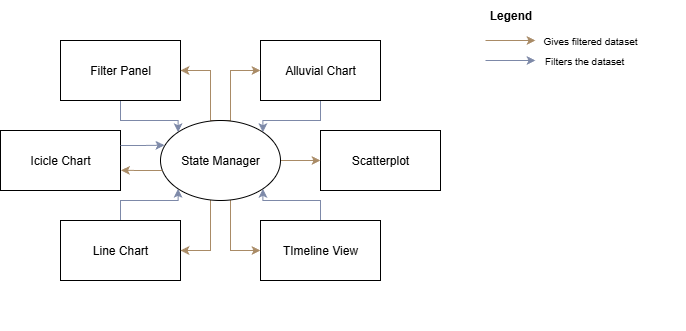
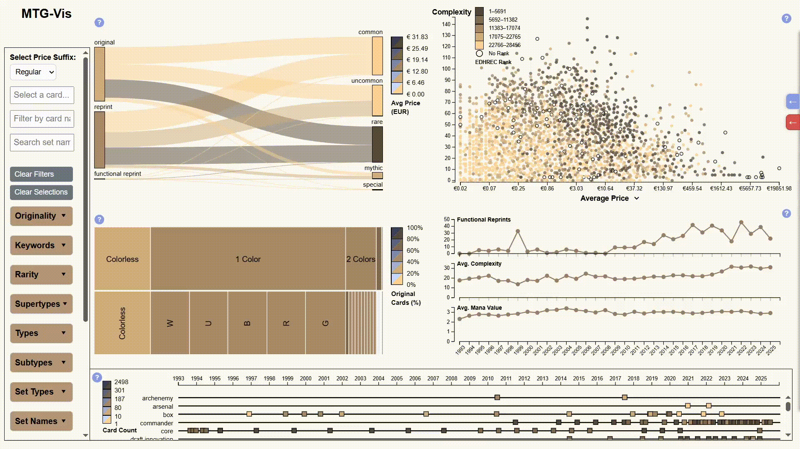
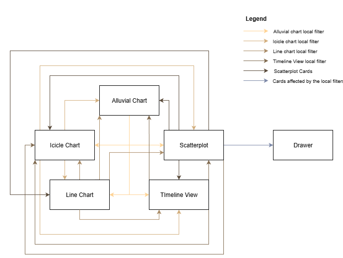

# MTG-VIS

> A web-based interactive dashboard to explore, analyze, and compare **Magic: The Gathering** cards through multiple coordinated visualizations.

This application was developed as part of a Master's thesis project and aims to help players and collectors better understand the relationships between card attributes such as **originality, rarity, color identity, and price trends**.  

---

## 🌐 Links
- **Live Demo:** [https://tiagofilipepereira.github.io/TeseMTG/](https://tiagofilipepereira.github.io/TeseMTG/)

---

## 🧩 Overview

The dashboard integrates several coordinated visualizations built with **D3.js**, each representing a different aspect of the card dataset:

| Visualization | Purpose |
|----------------|----------|
| **Alluvial Chart** | Visualizes the relationships between **Originality** and **Rarity**.|
| **Icicle Chart** | Depicts the **hierarchical composition of cards by color and type**. |
| **Scatterplot** | Plots individual cards by **price** and metrics such as **complexity** and **release date**. |
| **Line Chart** | Shows **aggregate temporal trends**, such as changes in average **mana value** across years. |
| **Timeline View** | Illustrates the **chronological progression of card sets**. |
| **Drawers** | Provide contextual details: the **blue drawer** lists selected cards, while the **red drawer** displays cards **excluded for lacking price data**. |

All modules communicate through a **shared event bus and global state**, ensuring that actions such as hovering, filtering, or selecting in one view propagate consistently across the entire interface.

---

## 🔍 Filtering Systems

Filtering is the central interaction mechanism of the dashboard. The system distinguishes between two complementary types of filters:

### 1. Global Filters (Filter Panel)
The **Filter Panel** provides centralized control over the global filters applied across all views.  
Filters can be **toggled** in two ways:
- **Directly from the Filter Panel**, by clicking on a category value (e.g., *Rarity*, *Set Type*, *Year*, *Color Identity*).
- **Indirectly from any visualization**, by **right-clicking** on an element representing that attribute (e.g., a node in the Alluvial chart or a segment in the Icicle chart).

Each filter category corresponds to a dataset dimension, and selected values update all visualizations to reflect the active subset.  
Multiple filters can be combined using different logic modes:
- **AND-OR:** combines filters using AND across categories, and OR within each category.
- **AND-AND:** applies strict AND logic both across and within categories.

The panel also displays **dynamic counts** for each filter option, recalculated based on the currently filtered dataset to support contextual exploration.

__*Global filters logic.*__

__*Global filters Example.*__

### 2. Local Filters (Selections)
Local filters are applied **directly through interactions within the visualizations**, allowing users to focus on specific subsets of cards without modifying the global filter state.

- **Clicking** or **brushing** on elements within a chart temporarily filters the dataset to include only the selected cards or categories.  
- **Double-clicking** on an empty area **clears the current local selection**, restoring the previous global view.  
- **Hovering** over a visual element highlights the corresponding cards across all coordinated views, without applying any filter.  

__*Local filters logic.*__

__*Local filters Example.*__

---

## 🧠 Data Foundation

All visualizations use the same preprocessed dataset (`dataset_card_details.json`), generated by a custom **data processing pipeline** that extracts, normalizes, and enriches attributes from Scryfall’s card database.

Key attributes include:

- `name`, `set_name`, `set_type`, `rarity`
- `color_identity`, `number_of_colours`
- `type`, `supertype`, `subtype`
- `originality` *(original, reprint, functional reprint)*
- `complexity`, `edhrec_rank`, `release_date`
- Price fields (`price_usd`, `price_eur`, `price_tix`, etc.)
- Derived metrics used in charts such as *average price by year* and *number of reprints*.

---

## ⚙️ Architecture

The app follows a modular structure:

- **`/src/idioms/`** — Each visualization (Alluvial, Icicle, etc.) is implemented as an independent module.
- **`state.js`** — Centralized state management with subscription and event hooks.
- **`script.js`** — Main orchestrator that loads data, builds indices, initializes all views, and maintains synchronization.
- **`data-process.py`** — Python preprocessing script that builds the normalized dataset.
- **`/docs/`** — Module-specific documentation.

All modules share a unified schema and coordinate through the **global `state`** and **event-driven updates** (e.g., selection, hover, filtering).

---

## 📖 Documentation

- [Data Processing](docs/dataProcessing.md)
- [Alluvial Chart](docs/alluvial.md)
- [Icicle Chart](docs/icicle.md)
- [Scatterplot](docs/scatterplot.md)
- [Line Chart](docs/line.md)
- [Timeline](docs/timeline.md)
- [Drawers](docs/hiddenDrawer.md)
- [Main Script/Global State](docs/stateManager.md)
- [Limitations/Future Work](docs/limitations.md)

---

## 🤝 Acknowledgements
Developed as part of a Master’s Thesis in Informatics Engineering, focused on **data visualization and interactive analysis tools** for *Magic: The Gathering* collections.  
Special thanks to all testers who provided feedback during the user study.

---

## 📬 Contacts

If you have questions about the project, need clarification on the architecture, or are continuing the development in future academic years, feel free to reach out:

- tiago.almeida.pereira@tecnico.ulisboa.pt

- tiago.alm.pereira@gmail.com

- joaopedro.moreira@protonmail.com

- Tomas.Alves@iscte-iul.pt

- daniel.j.goncalves@tecnico.ulisboa.pt

---

